# Week 5 — Offline Notes (Local Storage & Offline First)

## Identitas

| | |
|---|---|
| **Nama** | Laksamana AryaPutra |
| **NIM** | 244107020021 |
| **Kelas** | TI-3C |
| **Mata kuliah** | Praktikum Pemrograman Mobile (Flutter) — Minggu 5 |
| **Institusi** | Politeknik Negeri Malang |
| **Repository** | https://github.com/laksamanaap/PemMob26_3C_12_Laksamana-AryaPutra |

## Tujuan

Setelah praktikum ini saya mampu menyimpan preferensi lokal dengan SharedPreferences, mengelola data catatan di SQLite lewat repository, menampilkan empat state UI dengan Riverpod, serta menerapkan pola offline-first (dirty flag, cache-first posts, sinkronisasi, dan aturan konflik last-write-wins).

## Arsitektur

```
UI (pages/widgets)
    ↓ watch / read
Provider (lib/providers/)
    ↓
Repository (NoteRepository / PostRepository / PrefsRepository)
    ↓
SQLite / SharedPreferences

Sync: NoteActions.sync() → syncNotes() → remote simulasi → markAllSynced (dirty=0)
```

```
lib/
  main.dart, app_router.dart
  data/local/   note.dart, db.dart
  data/remote/  post.dart
  data/repositories/  note_repository.dart, post_repository.dart
  data/prefs.dart, sync.dart
  providers/    prefs, note, offline, post
  pages/        notes, settings, posts, note_detail
  widgets/      note_form_dialog, note_tile
```

---

## Hasil Praktikum 1 — SharedPreferences

Saya membuat `PrefsRepository` sebagai satu-satunya pintu ke SharedPreferences, lalu `DarkModeNotifier` (optimistic update + rollback) dan `lastOpenedProvider` yang membaca nilai lama sebelum menimpa. UI ada di `SettingsPage`.

**File:** `lib/data/prefs.dart`, `lib/providers/prefs_providers.dart`, `lib/pages/settings_page.dart`

**Screenshot — Pengaturan, tema terang**

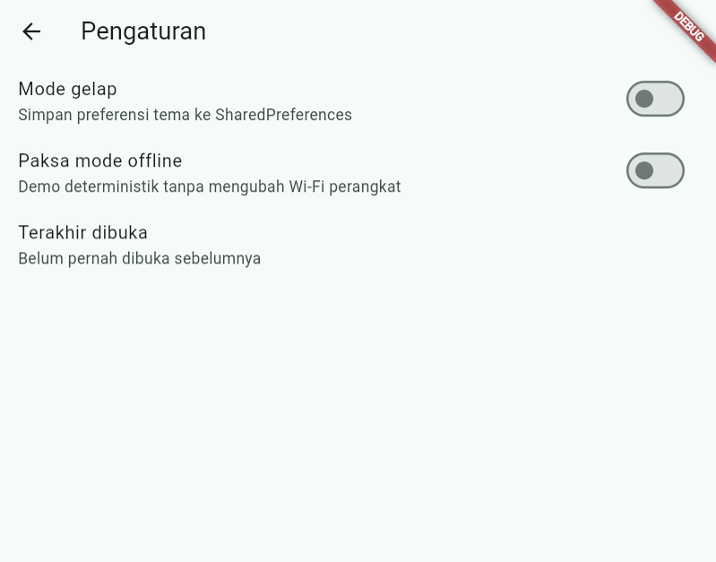

**Screenshot — Pengaturan, tema gelap**

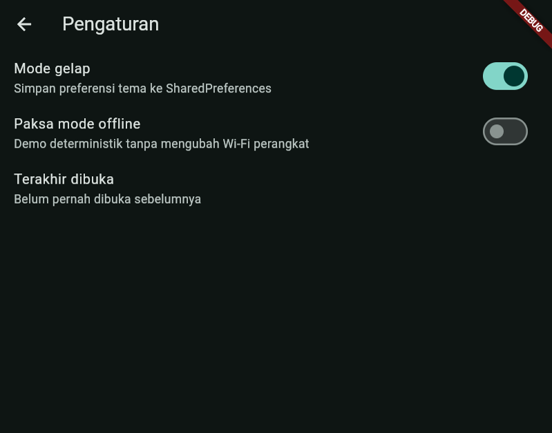

**Screenshot — Pengaturan, terakhir dibuka**

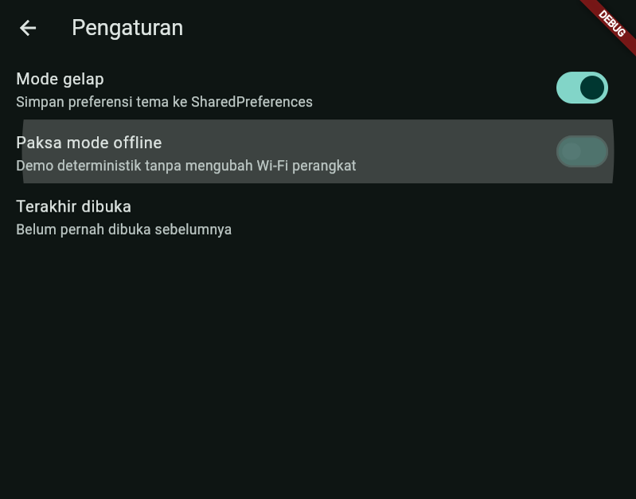

### Pertanyaan & Jawaban

**1.1** Mengapa `SharedPreferences.getInstance()` tidak boleh dipanggil di `build()`?  
Karena `build()` bisa dipanggil berkali-kali setiap rebuild dan harus tetap sinkron. Memanggil API async di situ membuat pembacaan berulang, UI bisa berkedip, dan sulit diuji. Saya bungkus lewat `PrefsRepository` + `prefsRepositoryProvider` yang di-override sekali di `main.dart`, sehingga hasil ter-cache dan bisa diganti di test.

**1.2** Jelaskan alur toggle mode gelap.  
Switch ditekan → `DarkModeNotifier.toggle()` → state langsung `AsyncData(next)` → `OfflineNotesApp` yang me-`watch(darkModeProvider)` rebuild sehingga `themeMode` berubah → `PrefsRepository.setDarkMode` menulis bool lewat platform channel ke disk (XML `shared_prefs` di Android). Saat dibuka ulang, `build()` notifier membaca nilai dari disk.

**1.3** Kelebihan dan risiko optimistic update.  
Kelebihan: UI responsif tanpa kedipan loading. Risiko: UI sempat menampilkan nilai yang gagal disimpan — karena itu saya rollback ke nilai sebelumnya di blok `catch` pada `toggle()`.

---

## Hasil Praktikum 2 — Model & SQLite

Saya membuat model `Note` (`toMap`/`fromMap`), skema `notes` + `cached_posts` di `db.dart` (version 1), dan `NoteRepository` dengan dependency injection `openDb` serta query `where: 'id = ?'`.

**File:** `lib/data/local/note.dart`, `lib/data/local/db.dart`, `lib/data/repositories/note_repository.dart`

**Screenshot — hasil `flutter analyze`**

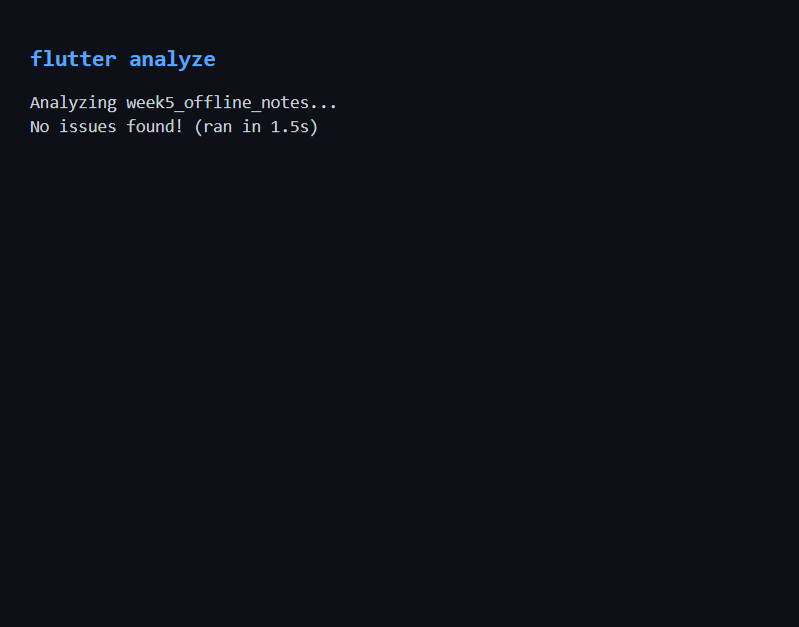

### Pertanyaan & Jawaban

**2.1** SQLite tidak punya tipe BOOLEAN; saya simpan `dirty` sebagai 1/0 di `toMap` dan konversi balik di `fromMap`.

**2.2** Parameter `openDb` adalah dependency injection: di produksi memakai `openAppDatabase`, di test `FakeNoteRepository` menyuntikkan fungsi yang melempar `UnimplementedError` lalu override method dengan list di memori — tanpa SQLite sungguhan.

**2.3** `where: 'id = ?'` + `whereArgs` mencegah SQL injection dan kesalahan escaping; nilai dikirim terpisah sebagai parameter.

**2.4** Tanpa menaikkan `version`, `onCreate` tidak jalan lagi karena berkas DB sudah ada → kolom baru tidak terbentuk → error `no such column`. Solusi: naikkan `version` + `onUpgrade` (ALTER TABLE), atau uninstall app saat development.

---

## Hasil Praktikum 3 — Halaman Catatan + Riverpod

Saya membuat `notesProvider`, `dirtyCountProvider`, dan `NoteActions` yang selalu meng-invalidate keduanya. UI `NotesPage` menangani empat state; form ada di `NoteFormDialog`.

**File:** `lib/providers/note_providers.dart`, `lib/pages/notes_page.dart`, `lib/widgets/note_form_dialog.dart`

**Screenshot — empty state (home Catatan Offline)**

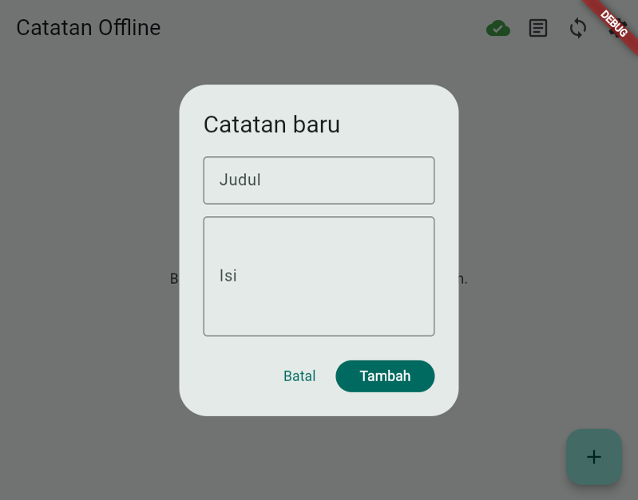

**Screenshot — validasi form (judul kosong)**

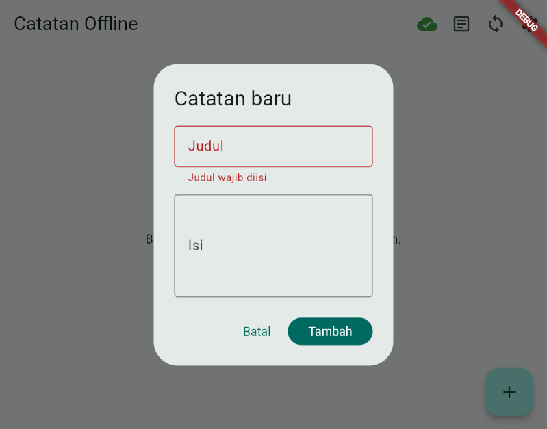

**Screenshot — daftar catatan**


**Screenshot — error state + tombol Coba lagi**

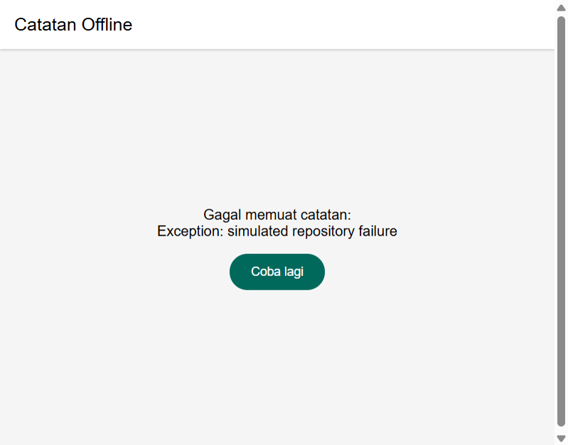

**Screenshot — mode pesawat, daftar tetap jalan**


### Pertanyaan & Jawaban

**3.1** Kedua provider membaca tabel yang sama dari sudut berbeda. Hanya invalidate `notesProvider` → daftar berubah tapi badge dirty basi; hanya `dirtyCountProvider` → badge benar tapi daftar tidak berubah. Makanya `_refresh()` meng-invalidate keduanya.

**3.2** Memicu error: override `noteRepositoryProvider` dengan repo yang melempar exception, atau sementara ubah nama tabel di `fetchNotes()`.

**3.3** Seluruh baca/tulis catatan menuju SQLite lokal; tidak ada operasi catatan yang butuh jaringan, jadi daftar tetap jalan di mode pesawat tanpa kode khusus offline.

### Tabel Uji Praktikum 3

| No | Skenario | Hasil aktual | Status (Lulus/Gagal) |
|---|---|---|---|
| 1 | Empty state | ⏳ isi setelah uji manual | ⏳ isi setelah uji manual |
| 2 | Validasi form | ⏳ isi setelah uji manual | ⏳ isi setelah uji manual |
| 3 | Tambah catatan | ⏳ isi setelah uji manual | ⏳ isi setelah uji manual |
| 4 | Ubah catatan | ⏳ isi setelah uji manual | ⏳ isi setelah uji manual |
| 5 | Hapus | ⏳ isi setelah uji manual | ⏳ isi setelah uji manual |
| 6 | Error state | ⏳ isi setelah uji manual | ⏳ isi setelah uji manual |
| 7 | Mode pesawat | ⏳ isi setelah uji manual | ⏳ isi setelah uji manual |

---

## Hasil Praktikum 4 — Offline-First

Saya menambahkan `forceOfflineProvider`, `syncNotes` + `resolveConflict`, `PostRepository` (transaksi + batch), `PostsNotifier` cache-first, tombol Posts/Sinkronkan, dan saklar force offline di pengaturan.

**File:** `lib/data/sync.dart`, `lib/providers/post_providers.dart`, `lib/pages/posts_page.dart`, …

**Screenshot — badge dirty sebelum sync**


**Screenshot — sync ditolak (force offline ON)**

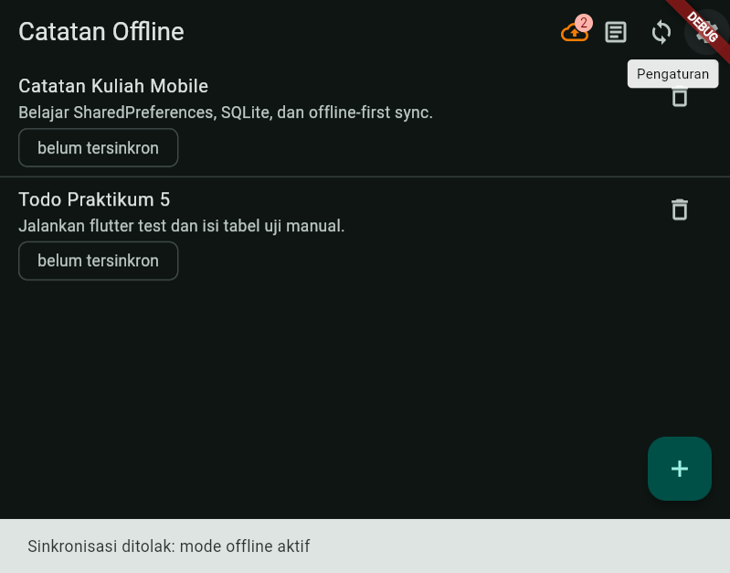

**Screenshot — sync berhasil**


**Screenshot — setelah sync (ikon hijau / badge hilang)**

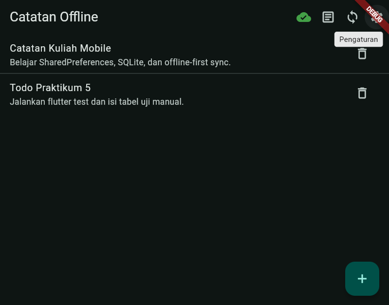

**Screenshot — Posts online**


**Screenshot — Posts offline (dari cache)**

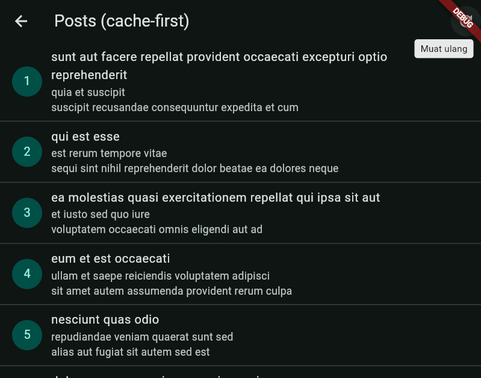

### Pertanyaan & Jawaban

**4.1** Cache-first cocok untuk artikel/katalog/posts: tampilkan lokal dulu, perbarui di background. Network-first cocok untuk harga saham, saldo, stok real-time — jaringan dulu, cache hanya cadangan.

**4.2** `markAllSynced()` menandai **semua** dirty bersih. Jika selama upload 1 detik pengguna mengedit catatan A, versi baru ikut ditandai bersih padahal belum terkirim. Perbaikan: tandai per `id` + `updated_at` yang benar-benar dikirim, atau tabel outbox.

**4.3** `forceOffline` membuat demo/test deterministik, tidak bergantung Wi-Fi kelas, bisa diotomatisasi, tanpa mengubah pengaturan perangkat.

**4.4** Transaksi membuat hapus + insert posts atomik; jika gagal di tengah, cache lama utuh. `batch` mempercepat ratusan insert.

### Tabel Uji Praktikum 4

| No | Skenario | Hasil aktual | Status (Lulus/Gagal) |
|---|---|---|---|
| 1 | Isi cache | ⏳ isi setelah uji manual | ⏳ isi setelah uji manual |
| 2 | Cache saat offline | ⏳ isi setelah uji manual | ⏳ isi setelah uji manual |
| 3 | Antrean dirty | ⏳ isi setelah uji manual | ⏳ isi setelah uji manual |
| 4 | Sync ditolak | ⏳ isi setelah uji manual | ⏳ isi setelah uji manual |
| 5 | Sync berhasil | ⏳ isi setelah uji manual | ⏳ isi setelah uji manual |
| 6 | Refresh background | ⏳ isi setelah uji manual | ⏳ isi setelah uji manual |

---

## Hasil Praktikum 5 — Testing

Tujuh test model/sync di `test/note_test.dart` memakai `FakeNoteRepository`; ditambah `post_provider_test.dart` (cache offline + OfflineException) dan `notes_page_test.dart` (empty state widget).

**Screenshot — hasil `flutter test`**

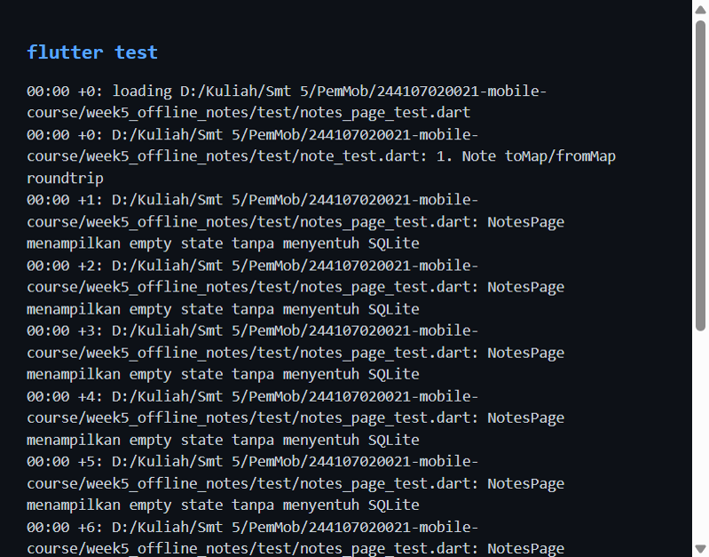

### Keluaran asli

```
Analyzing week5_offline_notes...
No issues found! (ran in 3.3s)
```

```
00:00 +10: All tests passed!
```

### Pertanyaan & Jawaban

**5.1** `ProviderContainer` + override membuat uji cepat, deterministik, tanpa emulator/plugin — fokus logika provider, bukan SQLite.

**5.2** Parameter `latency` memungkinkan `Duration.zero` di test sementara aplikasi tetap memakai jeda simulasi 1 detik.

**5.3** Test tambahan yang saya tulis: cache posts saat `forceOfflineProvider = true`. Penting karena memastikan strategi cache-first benar-benar melindungi UX offline. Kandidat lain: `updateNote` menandai dirty & memperbarui `updated_at` (sudah ada di test no. 4).

---

## Aturan Konflik yang Dipilih

Aplikasi memakai **last-write-wins** berdasarkan `updated_at` di fungsi `resolveConflict` (`lib/data/sync.dart`).

| Aturan | Ringkas | Kelebihan | Kelemahan |
|---|---|---|---|
| Last-write-wins | Timestamp terbaru menang | Sederhana, deterministik | Bergantung jam perangkat |
| Server-wins | Server selalu menang | Konsisten di pusat | Perubahan lokal bisa hilang |
| Merge per field | Gabung field | Lebih sedikit data hilang | Konflik semantik rumit |
| Tanya pengguna | Dialog pilih versi | Kontrol penuh | Mengganggu UX |

Alasan memilih LWW: cocok untuk modul single-user / simulasi sync tanpa UI konflik. Kelemahan: jam perangkat; plus `markAllSynced()` bisa race saat edit selama upload → perbaikan `WHERE id = ? AND updated_at = ?` atau **outbox**. Penghapusan langsung tak diketahui server → butuh **tombstone** (`deleted = 1`).

---

## Hasil AI Prompt Challenge

- Prompt lengkap: [docs/ai-prompt.md](docs/ai-prompt.md)
- Output awal: [docs/ai-output-awal.md](docs/ai-output-awal.md)
- Tabel final: [docs/perbandingan-storage.md](docs/perbandingan-storage.md)

**Ringkasan output AI:** membandingkan SharedPreferences/Hive/sqflite/Drift; awalnya merekomendasikan SharedPreferences + **Hive** untuk catatan.

**Temuan verifikasi (5 butir):**

1. Tidak menaruh daftar catatan di SharedPreferences → sesuai  
2. Skema punya `dirty` + `updatedAt` → sesuai  
3. Klaim reaktif: benar untuk Hive/Drift; sqflite di project ini reaktif lewat invalidate Riverpod → dikoreksi  
4. Dry-run Hive+Drift: **Would change 54 dependencies** → boilerplate Drift tinggi, sesuai  
5. Rekomendasi Hive untuk catatan → **ditolak**; keputusan final: SharedPreferences + **sqflite**

---

## Refactoring

1. `NoteTile` + chip "belum tersinkron" — commit `refactor(widgets): ekstrak NoteTile dengan chip belum tersinkron`

**Screenshot — NoteTile chip belum tersinkron**

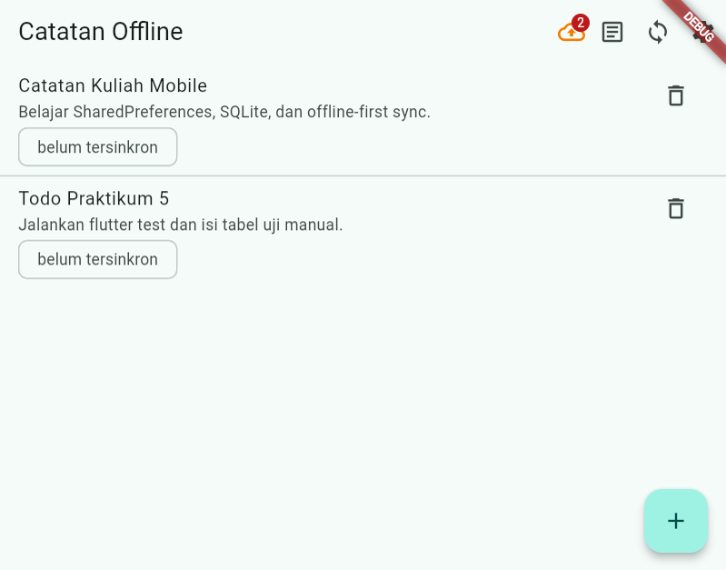

2. Pisah tanggung jawab repo/sync — commit `refactor(data): pisahkan tanggung jawab repository dan sync`
3. Detail + GoRouter — commit `feat(router): halaman detail catatan dengan GoRouter`

**Screenshot — halaman detail catatan**

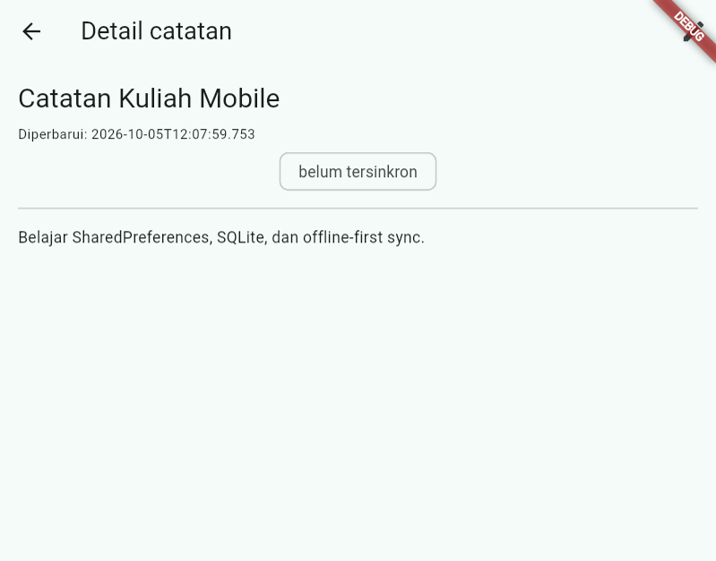

---

## Refleksi

1. **Mengapa daftar catatan tidak cocok di SharedPreferences?**  
   Satu string JSON berarti tiap ubah satu catatan = baca-urai-ubah-tulis ulang seluruh daftar. Tidak ada query/filter/urutan SQL, update parsial, atau transaksi. Dirty flag per catatan jadi rapuh dan lambat.

2. **Kapan cache-first cukup / tidak cukup?**  
   Cukup untuk artikel/katalog/posts yang boleh sedikit usang. Tidak cukup untuk harga real-time/saldo (perlu network-first). Data kolaboratif butuh aturan konflik / sync dua arah.

3. **Dirty flag sebagai antrean sync tanpa memblokir UI**  
   `NoteActions.sync()` memakai `async/await`; UI menampilkan badge dari `dirtyCountProvider` dan snackbar. Sync berjalan di background. Tabel outbox diperlukan bila banyak jenis operasi (create/update/delete), butuh urutan, retry, dan pelacakan penghapusan.

4. **Bagian rekomendasi AI yang ditolak**  
   Rekomendasi **Hive untuk catatan** saya tolak setelah verifikasi: project membutuhkan SQL (`ORDER BY`, transaksi cache posts) dan testing DI `openDb` tanpa menambah ~54 paket codegen Drift/Hive. SharedPreferences + sqflite tetap pilihan yang tepat.

---

## Checklist Verifikasi Mandiri

- [x] `flutter analyze` → No issues found!
- [x] `flutter test` → 10 test lulus
- [x] Tidak ada import `sqflite` / `shared_preferences` di `lib/pages/` & `lib/widgets/`
- [x] Tidak ada definisi provider di `lib/pages/`
- [ ] Badge dirty sebelum/sesudah sync, posts tanpa internet, mode pesawat — **perlu uji manual**

---

## Catatan Adaptasi

- File `_ref/modul-referensi.md` tidak tersedia di repo; implementasi mengikuti `MASTER_PROMPT_CURSOR_week5_offline_notes.md`.
- Riverpod 3.4.3 **tidak** menyediakan `StateProvider` → diganti `NotifierProvider` (`ForceOfflineNotifier`).
- `go_router` 18.x dipakai untuk rute `/`, `/note/:id`, `/posts`, `/settings`.
- Build Android: `kotlin.incremental=false` + heap Gradle diturunkan (`-Xmx1536m`) di `android/gradle.properties` — sebelumnya daemon crash OOM karena `-Xmx8G` sementara disk C: hampir penuh.
- Flutter Web: sqflite diganti `MemoryNoteRepository` / `MemoryPostRepository` (hanya `kIsWeb`) agar bisa demo & ambil screenshot.

---

## Kesimpulan

Hal terpenting yang saya pelajari adalah memisahkan UI dari storage lewat repository + provider, lalu memakai dirty flag dan cache-first agar aplikasi tetap berguna tanpa jaringan — dengan sync yang bisa ditolak/diuji secara deterministik lewat `forceOffline`, bukan hanya mengandalkan mode pesawat.

## Dokumentasi tambahan

- [docs/uji-offline.md](docs/uji-offline.md)
- Tag git: `praktikum-0` … `praktikum-7`, `praktikum-9`

